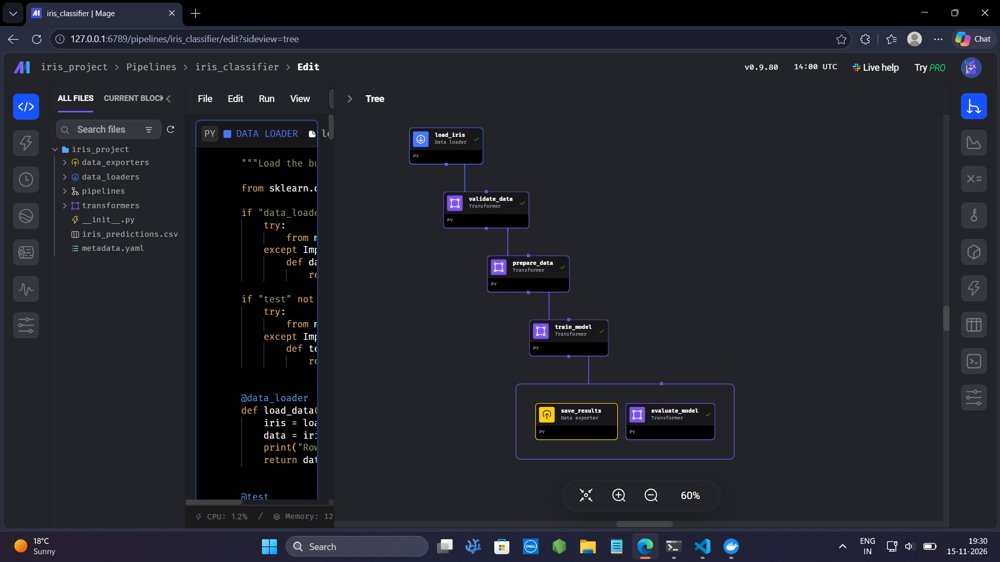
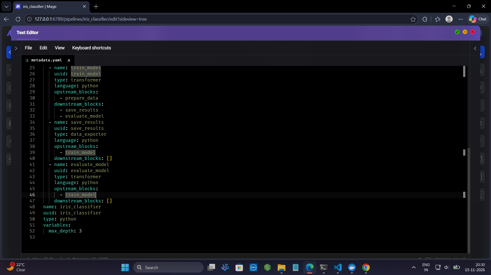
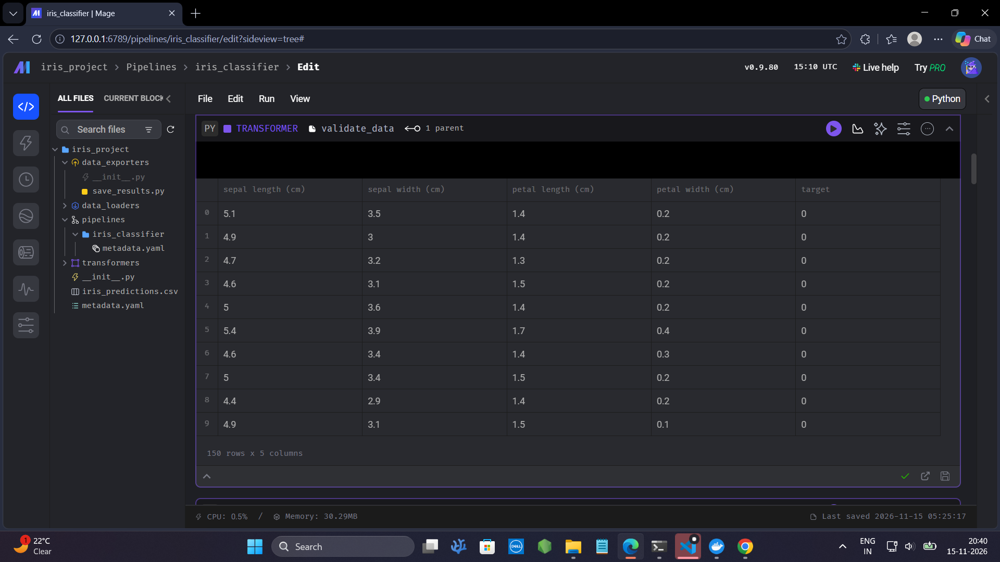
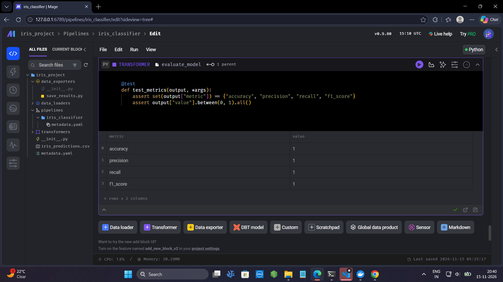
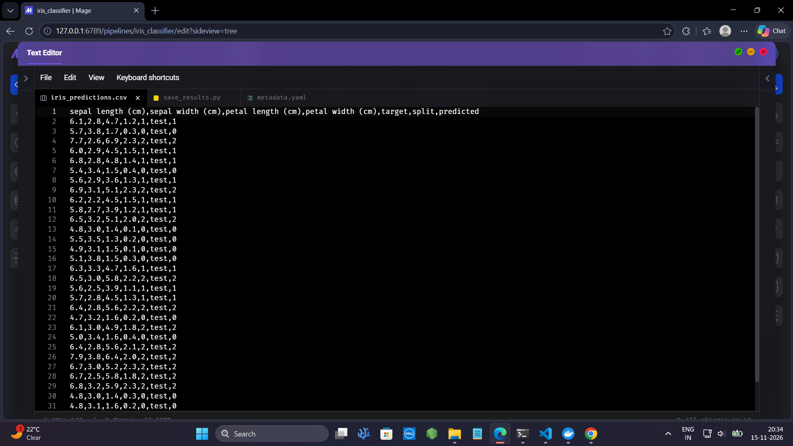

# From Git to Gold

**Student:** Budida Ajay  
**Roll number:** 23BCS061  
**Status:** Submission draft — Parts A–D implementations and the bonus integration code are present. Local tests, the Mage CLI pipeline, the RabbitMQ routing demo, and CI screenshots are available. The bonus cell has not been run with live RabbitMQ and Snowflake credentials, so no live bonus result is claimed.

## Part A — Git and CI/CD

### A1. Repository

The repository is organized into `elt/`, `iris_project/`, `stream/`, `tests/`,
and `.github/workflows/`. The public repository is
https://github.com/Ajay9704/freshcart-pipelines.

Recent local history:

```text
33fc922 Document pipeline execution and assignment findings
34da3ce Add tests for data preparation and pipeline components
0d3fb4b Develop FreshCart ELT pipeline and validation checks
ac42f16 Add RabbitMQ dispatcher and message drivers
d5ec2d1 Build Mage Iris classification pipeline
4cf16ed Set up assignment repo and CI
```

### A2. Where Git commands act

| Command | Where the change happens | What exactly happens |
|---|---|---|
| `git init` | Working folder / local repository | Creates the `.git` metadata directory so Git can track this folder. |
| `git add train.py` | Staging area | Stages the current contents of `train.py` for the next commit. |
| `git commit -m "msg"` | Local repository | Saves the staged snapshot as a commit in the local history. |
| `git remote add origin URL` | Local repository configuration | Records the remote URL under the name `origin`; it does not upload files. |
| `git push -u origin main` | Remote Git repository | Uploads local commits to the remote `main` branch and sets its upstream. |
| `git pull origin main` | Local repository and working folder | Fetches remote commits and integrates them into the current local branch. |

After `git commit`, a teammate cannot see the code on GitHub because the commit
exists only in the local repository until it is pushed.

### A3. CI

`tests/test_prepare_data.py` checks that the Iris transformer returns exactly
120 training rows and 30 test rows. The GitHub Actions workflow runs pytest on
pushes and pull requests using Python 3.12. The required green and intentionally
red GitHub Actions runs were exercised: the initial workflow passed, the
temporary `test_size=0.3` change failed as intended, and restoring
`test_size=0.2` made the workflow pass again. The passing, intentional failure,
and restored passing run are included in Appendix A.

## Part B — FreshCart ELT on Snowflake

The notebook in `elt/freshcart_elt.ipynb` now reads credentials from Colab
Secrets and contains the `unsupported_currency` validation and the sixth
future-order quality check.

### B1. Baseline

The pipeline completed successfully. The Snowflake connector printed proxy
configuration warnings, but all SQL stages and quality checks completed.

| Check | Expected | Observed |
|---|---:|---:|
| Raw order rows in bronze after one run | 8 | 8 |
| Rows in `silver.orders_clean` | 6 | 6 |
| Quarantined orders | 2 | 2: ORD-1004, ORD-1006 |
| Rows in `silver.orders_dedup` | 4 | 4 |
| Gold orders | 4 | 4 |
| Gold revenue | ₹7,785.00 | ₹7,785.00 |
| Gold loyalty points | 126 | 126 |
| Share rejected | 25% | 25% |

The sixth check, future-dated orders in silver, returned 0 (`OK`) in the
baseline run. The available Colab screenshots include a later intentional
future-date failure and cleanup sequence; a clean baseline screenshot is not
present, so the baseline figures below are reported from the recorded run and
not represented as a screenshot-backed result.

### B2. Record trace

In bronze, the website copy of ORD-1003 is a flat object with fields such as
`order_id`, `cust_email`, `amount`, and `updated_at`; its `amount` is null. The
mobile copy is nested and uses `orderId`, `customer.email`, `total.value`, and
`updatedAt`; its amount is ₹2,100 and its update time is later.
`SQL_10_ORDERS_CLEAN` maps the website fields directly and maps the mobile
fields from their nested JSON paths into the same normalized columns. A null
amount is allowed, so both versions can be cleaned. In `SQL_20_ORDERS_DEDUP`,
`QUALIFY ROW_NUMBER() OVER (PARTITION BY order_id ORDER BY updated_at DESC,
ingest_seq DESC) = 1` keeps the newer mobile copy. Gold calculates its amount
as ₹2,100 × INR rate 1.0 = ₹2,100; Meera's Platinum multiplier is 3, so
`FLOOR(2100 / 100) × 3 = 63` loyalty points.

For ORD-1005, Priya earns Gold points because its order date, 2026-09-03, is
the start date of her Gold SCD2 row. ORD-1001 is dated 2026-09-01, within her
Silver row. The point-in-time join uses matching email and
`order_date BETWEEN valid_from AND valid_to` in `SQL_40_GOLD`; the
`ref.tier_multiplier` table is joined with `m.tier = c.tier`.

### B3. Currency validation

Before adding the rule, ORD-1006's reasons were `bad_email` and `bad_pincode`.
The assignment's requested validation now adds `unsupported_currency`, and
the baseline run showed all three reasons for ORD-1006. Gold totals do not
change because this order already fails validation and is quarantined rather
than included in `silver.orders_clean` and gold. On a rerun, the quarantine
`INSERT` uses `NOT EXISTS` on source, null-safe order ID, and the raw row's
`UPDATED_AT` timestamp to avoid inserting the same source/order/version again.

### B4. SCD2 and idempotency

The following prediction was recorded before adding the new event and running
the pipeline:

| Quantity | Prediction | Actual |
|---|---:|---:|
| Rows for CUST-02 in `dim.customers_scd2` | 2 | 2 |
| Tier used for ORD-1002 | Gold | Gold |
| Loyalty points for ORD-1002 | 70 | 70 |
| Total gold loyalty points | 161 | 161 |
| Gold rows whose `published_at` changed | 1 | 1 |

Calculation: ORD-1002 is USD 42.50 on 2026-09-01, when the daily FX rate is
83.20 INR/USD, so its INR amount is ₹3,536. Gold's multiplier is 2;
`FLOOR(3536 / 100) × 2 = 70` points, 35 more than its baseline Silver value
of 35. The predicted new total is 126 + 35 = 161. The observed SCD2 rows are
Silver from 2024-01-15 through 2026-08-14 and Gold from 2026-08-15 onward.
The run reported 4 gold orders, ₹7,785.00 revenue, and 161 points. Comparing
before and after `published_at` values showed that only ORD-1002 changed.

With the baseline input, bronze grows by eight order rows per run because every
extracted website/mobile copy is appended. The final gold `MERGE` matches by `order_id`
and updates a matched row only when its `row_hash` changes. With identical
inputs, the hash is unchanged, so gold totals and `published_at` stay stable;
the new Arjun event changes ORD-1002's tier-dependent hash and should update
that one row.

The later totals screenshot displays 96 bronze order rows, 2 quarantine rows,
4 gold orders, ₹7,785.00 revenue, and 161 points. This supersedes an earlier
draft value of 80 bronze rows; bronze increases on each extraction, so the
count depends on how many runs had been made when the screenshot was captured.
The repeated input did not add duplicate gold orders. The earlier pipeline
run comparison recorded that all four Gold `published_at` timestamps were
stable across the compared rerun.

### B5. Quality check and ELT explanation

The sixth check is `COUNT_IF(order_date > CURRENT_DATE())` over
`silver.orders_dedup`; it returned 0 in the baseline run. For the intentional
failure demonstration, a temporary 2099-dated order was added. The screenshot
showed `future-dated orders in silver = 1 PROBLEM`; it also showed one order
with an amount but no FX rate, and the temporary order appeared in gold,
confirming that quality checks report problems but do not stop the pipeline.
After removing the mock order and rerunning, the future-date check returned
`0 OK`, gold returned to 4 orders, and the total remained ₹7,785.00 and 161
points. The run log also confirmed the web input returned to its original six
records (plus two mobile records). The available future-date failure
screenshot is included in Appendix B; a legible screenshot showing every
quarantine reason for ORD-1006 and a clean baseline screenshot are not
available.

FreshCart is a good fit for ELT because the original web and mobile JSON can
be loaded into Snowflake first, then standardized, validated, deduplicated,
and enriched with SQL where the data is stored. Keeping the raw records in
bronze also makes it possible to revise the transformations and reprocess
without extracting the source data again. ETL is more appropriate when data
must be filtered or masked before it can enter the warehouse, such as a
compliance rule that prohibits landing raw personal information.

## Part C — Mage Iris pipeline

The Mage-compatible blocks and pipeline metadata are in `iris_project/`. The
full project pytest suite passed locally: **16 passed**. The Mage CLI was run
with `--test` for each `max_depth` from 1 through 5, using the supplied fixed
split. Each run loaded 150 Iris rows. The model block produced these observed
test accuracies:

| `max_depth` | Test accuracy | 80% block check |
|---:|---:|---|
| 1 | 0.633 | Fails; Mage exits 1 and no predictions CSV is created |
| 2 | 0.967 | Passes; Mage exits 0 and predictions CSV is created |
| 3 | 1.000 | Passes; Mage exits 0 and predictions CSV is created |
| 4 | 1.000 | Passes; Mage exits 0 and predictions CSV is created |
| 5 | 1.000 | Passes; Mage exits 0 and predictions CSV is created |

Before each run, the previous `iris_project/iris_predictions.csv` was removed so
its presence proves that the current run reached the exporter. At depth 1, the
model block raised `Model accuracy is below 80%`, the pipeline exited
unsuccessfully, and the CSV remained absent. At depths 2–5, each run completed
successfully and wrote the CSV. The exporter resolves its output using Mage's
project path, and its block test verifies the saved file contains 30 rows and
the expected prediction columns.

### C4. Own block and test

`validate_data` is the added transformer between `load_iris` and
`prepare_data`. Its block test checks that the output has no missing values
and contains all three Iris classes; the project-level test also runs this
block before the train/test preparation step. Appendix C shows the block and
its place in the pipeline graph.

For `max_depth=3`, the locally evaluated confusion matrix was:

```text
           predicted
actual      0   1   2
       0   10   0   0
       1    0   9   0
       2    0   0  11
```

The depth-3 evaluation reported accuracy 1.000, precision 1.000, recall 1.000,
and F1-score 1.000. The five depth experiments and CSV-gating observations
were verified through the Mage CLI. Appendix C includes the graph, metadata,
metrics table, input preview, and exported CSV. The file named
`confusion_matrix.png` is a screenshot of the metrics table, not a confusion
matrix; the matrix values above come from the verified local evaluation
output.

## Part D — RabbitMQ food-order stream

### D1. Routing table

| # | Routing key | Receiving queues |
|---:|---|---|
| 1 | `bangalore.koramangala.food` | Ravi, Meena, Control |
| 2 | `bangalore.indiranagar.ride` | Priya, Arjun, Control |
| 3 | `bangalore.whitefield.ride` | Arjun, Control |
| 4 | `chennai.tnagar.food` | Karthik |
| 5 | `chennai.whitefield.ride` | dropped |
| 6 | `bangalore.koramangala` | Control |

`*` consumes exactly one routing-key word, so the three-word driver patterns do
not match the two-word key in row 6. `#` consumes zero or more words, so
`bangalore.#` does match it.

### D2–D3. Implementation and acknowledgements

The dispatcher and driver scripts are in `stream/`. Unit tests verify that
every tenth payload omits `zone`, that such deliveries use NACK with
`requeue=False`, and that complete deliveries are ACKed. A RabbitMQ broker was
run in Docker with its AMQP port bound to `127.0.0.1`. Six drivers were started
with the assignment's binding patterns.

The deterministic D1 check published `bangalore.koramangala.food`; exactly
Ravi, Meena, and Control received it. The two-minute dispatcher run published
60 requests in 121.7 seconds. The driver logs showed 76 valid deliveries and
10 missing-zone rejections. Example console output:

```text
Arjun received bangalore.whitefield.ride: {"id": "64501dbc-2b96-42f7-9443-8d8a194d7a34", "city": "bangalore", "type": "ride", "ts": "2026-11-15T13:46:21.762076+00:00", "zone": "whitefield"}
Arjun rejected message 5a894ff8-3227-4e95-a901-57d20413fb98; missing fields: zone
```

`basic_ack` removes a successfully processed delivery from the queue. If a
driver disconnects before acknowledging a delivery, RabbitMQ can requeue it
for redelivery. Requeueing a permanently malformed message would create a
repeated delivery loop, so the invalid request uses `basic_nack(requeue=False)`
to discard it.
The RabbitMQ run was verified from the live terminal logs; a dedicated
RabbitMQ screenshot was not saved in the current screenshot folder.

### D4. Bonus — RabbitMQ to Snowflake

The bonus implementation is in `stream/freshcart_consumer.py`,
`stream/freshcart_publisher.py`, `elt/rabbitmq_ingest.py`, and the final
integration cell in `elt/freshcart_elt.ipynb`. The consumer declares a
temporary queue on the existing topic exchange, collects for 60 seconds,
acknowledges JSON orders with the required FreshCart fields, and rejects
malformed messages without requeueing. The deterministic publisher emits the
same valid Arjun order three times. The notebook passes the collected records
to the existing `write_landing()` helper, loads the resulting file through
`load_file()`, and reuses the existing cleaning, deduplication, enrichment,
and hash-guarded Gold `MERGE`.

The notebook then writes and loads the same batch a second time and checks
that Gold order count, INR revenue, loyalty points, and the streamed order's
`published_at` timestamp remain unchanged. The consumer, publisher, and
landing/load handoff pass mock-based tests. **The authenticated notebook cell
has not been run against RabbitMQ and Snowflake**, because no reachable
`RABBITMQ_URL` or Snowflake credentials are available in this local session.
Therefore the implementation and its tests are verified, but a live bonus
result is not claimed.

## Part E — Integration and reflection

```text
Git -> staging -> commits -> GitHub -> CI tests
                               |
       +-----------------------+--------------------------+
       |                       |                          |
FreshCart ELT              Mage Iris                RabbitMQ stream
landing -> bronze ->       data -> validate ->      dispatcher -> drivers
silver -> gold             model -> CSV             -> FreshCart consumer
                                                       -> landing -> gold
```

### Reflection

This assignment showed why pipeline behavior must be checked at each boundary,
not inferred from a green block or a successful command alone. The Mage
exporter initially wrote outside the project tree, so the predictions existed
but were not visible where Mage users expected them. The RabbitMQ publisher
also exposed a library-specific detail: with publisher confirms, Pika can
return `None` for a successful publish, so treating every false-like value as
failure caused a false error. In the ELT flow, retaining raw data in bronze
made it possible to rerun transformations and compare stable Gold results.
The stream-to-lakehouse code follows the same principle by preserving each
batch with a run ID and checking an identical replay. The remaining limitation
is evidential rather than an implementation claim: the bonus cell still needs
a live run with reachable broker and Snowflake credentials before its
end-to-end result can be reported.

## Appendix A — GitHub Actions

.png)

.png)

.png)

## Appendix B — FreshCart / Colab

.png)


The available screenshot set also includes detailed table outputs. The image
`Screenshot 2026-11-15 202319.png` truncates the quarantine reasons, so it is
not used as proof that all three ORD-1006 reasons are legible. The screenshots
`202414` and `202438` appear duplicated; only one is included here.
The original clean baseline and a separate post-cleanup screenshot are not
available in the folder.

## Appendix C — Mage










